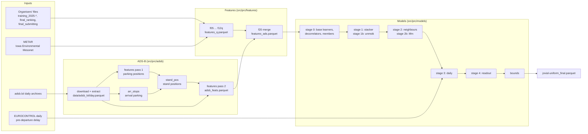

# Architecture

How the code is organised, how data moves through it, and which file each step writes and reads. The README explains what each stage does and why it is
there; `docs/DESIGN.md` gives the 2025 evidence behind each choice. This note is the map for reading or changing the code.

## 1. Overview

Everything runs from `scripts/run_final.sh`, one step at a time, in the order shown, including every gate (section 5).

## 2. Repository map

| Path | Role |
|---|---|
| `scripts/run_final.sh` | End-to-end run: weather, features, ADS-B passes, every learner and gate, assembly |
| `scripts/build_features.sh` | Feature steps 05 to 12q (called by `run_final.sh`) |
| `scripts/fetch_adsb.sh` | Download and reduce adsb.lol days for given months |
| `src/prc/config.py` | Run configuration from environment variables (data folder, training files, target file, excluded months, weather folder) |
| `src/prc/data/fetch_weather.py` | METAR download per airport and month |
| `src/prc/data/make_target.py` | Builds a test-style file from a labelled 2025 month (labels saved apart) for dry runs |
| `src/prc/features/f05_base.py` … `f12q_queue.py` | Feature steps; each reads the previous step's parquet and writes the next (dictionary in `docs/FEATURES.md`) |
| `src/prc/features/f20_adsb_merge.py` | Joins the ADS-B columns listed in `configs/v22_ads_cols.json` onto the feature table |
| `src/prc/adsb/download.py`, `extract.py` | Resumable download of a day's archive; positions inside each airport's box |
| `src/prc/adsb/features.py` | Per-departure ground-track timing (joins by callsign, aircraft address, lift-off) and, with `STAND_POS`, the assigned-stand reading |
| `src/prc/adsb/arr_stops.py` | Parking positions of 2025 arrivals |
| `src/prc/adsb/stand_pos.py` | Stand positions from 2025 departures (label rule) and, at five airports, from arrivals |
| `src/prc/adsb/stand_map.py` | Builds `configs/stand_map.parquet` (feeds only `ads_sv*` columns, which the model does not read) |
| `src/prc/models/pipeline.py` | All model stages, their gates and the assembly |
| `src/prc/models/daily.py` | Daily reconciliation (stage 3): `frame`, `fit`, `apply`, `load_K` |
| `src/prc/validate/compare.py` | Gate for a change that re-trains the whole pipeline (compares two output folders) |
| `src/prc/validate/*` (others) | Evaluated ideas that were rejected; kept so the negative results can be reproduced |
| `configs/` | `iata2icao.json`, `v22_ads_cols.json`, `stand_map.parquet` |
| `docs/decisions/` | The gate decisions of the submitted file (copies of `outputs/final/*.json`) |
| `docs/paper.pdf`, `docs/paper/` | The paper; the scripts and data behind its figures and tables |

## 3. Data flow and files

All model outputs go to `$PRC_OUT` (default `outputs/final`). Large inputs live in `data/` and are not part of the repository.

| Step | Command | Reads | Writes |
|---|---|---|---|
| Weather | `prc.data.fetch_weather` | internet | `data/weather/*.csv` |
| Features | `scripts/build_features.sh` | organisers' files, weather | `features_q.parquet` (one row per departure of 2025 and of the scored file, 246 columns) |
| ADS-B days | `scripts/fetch_adsb.sh` | internet | `data/adsb_lol/<day>.parquet` |
| ADS-B pass 1 | `prc.adsb.features` | days, departures | `adsb_feats_p1.parquet` (parking positions) |
| Arrival stops | `prc.adsb.arr_stops` | days, 2025 arrivals | `arr_stops_2025.parquet` |
| Stand positions | `prc.adsb.stand_pos` | pass 1, arrival stops, 2025 labels | `stand_positions.parquet` |
| ADS-B pass 2 | `prc.adsb.features` with `STAND_POS` | days, stand positions | `adsb_feats.parquet` |
| Merge | `prc.features.f20_adsb_merge` | `features_q`, `adsb_feats` | `features_ads.parquet` (= `$PRC_FEAT`, 282 columns) |
| Stage 0 | `pipeline base --learner NAME` | `features_ads` | `oof_base_NAME.parquet`, `pred_base_NAME[_sK].parquet` |
| Stage 1 | `pipeline stacker` | features, base | `oof_corr.parquet`, `pred_corr.parquet` |
| Stage 2 | `pipeline stage2` | stage 1 | `oof_s2.parquet`, `pred_s2.parquet` |
| Stage 1b | `pipeline unmstk` | features, base, `adsb_feats` | `oof_ucorr.parquet`, `pred_ucorr.parquet`, `unm_weight.json` |
| Stage 2b | `pipeline ltfm` | stage 1 | `oof_lt.parquet`, `pred_lt.parquet`, `ltfm_weight.json` |
| Gates | `pipeline dec`, `member`, `u95`, `daily`, `readout` | everything above | `dec_weight.json`, `NAME_weight.json`, `u95_weight.json`, `daily.json`, `readout.json` |
| Assembly | `pipeline assemble` | everything above | `validation_2025.json`, `jovial-uniform_final.parquet` |

## 4. One assembly function, two paths

`_assemble(rows, kind)` in `pipeline.py` builds the prediction of the whole pipeline from the stage outputs and the gate decisions:

* `kind="oof"`: the 2025 rows, from the `oof_*` files. Every stage's out-of-fold prediction was made by a model that did not see the held-out
  two-month fold, and the daily layer and stage 4 refit their parameters without that fold. This is the 2025 validation.
* `kind="pred"`: the scored rows, from the `pred_*` files (final fits on all of 2025, averaged over seeds).

The order inside `_assemble` is fixed: base (`_base`: blend, decorrelators and members as their decision files say) → stage 1 on covered rows →
stage 2 or 2b → stage 1b on rows without NM clock → bounds → daily layer → bounds → stage 4 → bounds. Each optional part is read from its decision
file and is skipped when the file says the gate failed, so a rejected component has no effect. The `use_*` switches of `_assemble` remove one part at
a time; the gates use them to compare the pipeline with and without a component.

Rows are routed by `lanes()`: `covered` (NM clock and own ground track), `uncovered` (NM clock, no usable track), `unm_nr` (no NM clock, outside
Rome) and `unm_rome`. Lanes depend only on fields that exist for the scored rows.

## 5. Gates and decisions

Every optional component has a gate step that evaluates it through `_assemble(..., "oof")` on top of what is already accepted, checks the rule
(each month in `PRC_GATE_MONTHS` better, the four-month total better, the 100 most-improved rows carrying less than the gain) and writes a JSON
decision with its weight and the per-month changes. `_assemble` reads these files, so re-running a gate re-derives the decision. Changes that
re-train the whole pipeline (a new ADS-B extraction) are compared folder against folder with `prc.validate.compare`.

## 6. Configuration

| Variable | Used by | Meaning |
|---|---|---|
| `PRC_DATA`, `PRC_TRAIN_GLOB`, `PRC_TARGET`, `PRC_TEMPLATE`, `PRC_WEATHER`, `PRC_EXCLUDE_MONTHS` | `config.py` (`PRC_TEMPLATE`: `pipeline.py`), `run_final.sh` | Data folder, labelled files, file to predict, submission template, METAR folder, months left out of training |
| `PRC_OUT`, `PRC_FEAT` | `pipeline.py` | Output folder; feature table with ADS-B columns |
| `PRC_GATE_MONTHS` | gates | Training-year months every gate must improve (default `1,2,6,7`) |
| `PRC_EC_DIR` | `daily.py` | Folder of the EUROCONTROL daily delay files |
| `PRC_SMOKE` | `pipeline.py` | 3 % of the rows and short fits: checks the code path in minutes |
| `PRC_GPU`, `PRC_GPU_DEVICES`, `PRC_CPU_ONLY`, `PRC_THREADS` | learners, `run_final.sh` | CatBoost on GPU; skip the GPU member; thread count |
| `PRC_TEAM`, `PRC_VERSION` | `assemble` | Name of the submission file |
| `ICAO_LINK`, `LIFTOFF_LINK`, `STAND_POS`, `ADSB_OUT`, `ADSB_DAYS` | `adsb/features.py` | Join by aircraft address; lift-off link; stand-position file; output file; restrict to listed days |
| `ARR_STAND_AIRPORTS` | `adsb/stand_pos.py` | Airports at which arrival-located stands are used (default EDDF, EDDM, EHAM, LEBL, LSZH) |

## 7. Invariants

* No departure label of the scored period is read anywhere; arrival records of the scored file are used, as the data description allows.
* Every stage that feeds another is trained on out-of-fold inputs, so the 2025 validation measures the pipeline as it is applied.
* Every kept or rejected component leaves a decision file; `docs/decisions/` holds those of the submitted file.
* Nothing refers to a calendar period: the period is set by the variables in section 6.

## 8. Where to change things

| Task | Place |
|---|---|
| New feature | a step in `src/prc/features/` and a line in `scripts/build_features.sh` (or a new ADS-B column in `adsb/features.py` and `configs/v22_ads_cols.json`) |
| New base learner or member | an entry in `LEARNERS` (and `MEMBERS`) in `pipeline.py`, then `base` and `member` (README, "Add a model") |
| New correction stage | a `cmd_*` function with its gate and a block in `_assemble`, following `cmd_unmstk` or `cmd_readout` |
| New airport | `APTS` in `adsb/extract.py`, `APTS9` in `pipeline.py`, `APTS` in `daily.py` (README, "Add an airport") |
| New period | the variables of section 6 (README, "Predict another period") |
